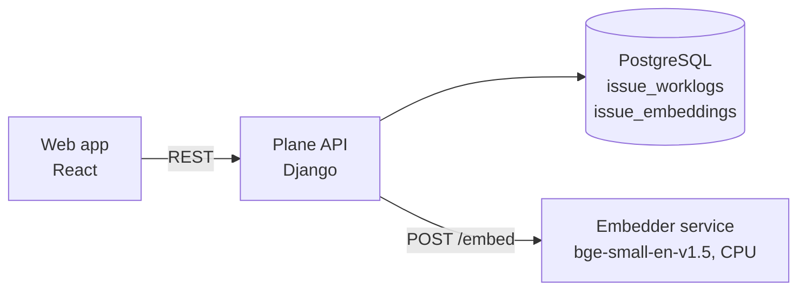

# Plane Extension: Time Tracking & AI Semantic Search

---

## 1. Resume Entry

**Plane Extension: Time Tracking & AI Semantic Search** | [GitHub](https://github.com/Prathamesh250205/plane-time-tracking-search) | [Live Demo](https://prathamesh250205.github.io/plane-time-tracking-search/demo/) | [Demo Video](https://prathamesh250205.github.io/plane-time-tracking-search/demo-video.mp4)
*Python, Django, TypeScript, React, PostgreSQL, Docker, Embeddings (ONNX)*

- Extended **Plane**, a large open-source project management platform (Django + React monorepo), with **per-item time tracking** and a **person × day project timesheet**: new PostgreSQL tables and migrations, **REST APIs** with owner-only edit permissions, and database-side aggregation by member, work item and day.
- Built **self-hosted semantic search** as a separate Python **microservice** (384-dim `bge-small-en-v1.5` via fastembed/ONNX), so *"the app feels sluggish"* finds *"slow dashboard"*; **cached embeddings by content hash** so each query re-embeds only new or changed items, with no background jobs.
- Wrote **16 API contract tests** (with a fake embedder, so no model is needed in CI) and a **GitHub Actions** pipeline that builds the Docker web image and checks the new features are in the bundle; deployed with Docker Compose.

**Short version (if space is tight):**
- Added time tracking, timesheets and AI semantic search to Plane, an open-source project management tool (Django, React, PostgreSQL); the embedding microservice is self-hosted with content-hash caching, and the work has 16 contract tests and Docker CI.

---

## 2. Portfolio Write-up

### Plane+: Time Tracking & Smart Search
*Adding the features a popular open-source project manager was missing, with no cloud APIs and no data leaving the server.*

**Links:** [GitHub](https://github.com/Prathamesh250205/plane-time-tracking-search) · [Live Demo](https://prathamesh250205.github.io/plane-time-tracking-search/demo/) · [Demo Video](https://prathamesh250205.github.io/plane-time-tracking-search/demo-video.mp4)

### The problem
Plane is a popular open-source alternative to Jira. Its free community edition has no way to log hours, see who worked on what, or search tasks except by exact keywords.

### What I built
- **Time tracking.** Every task gets a "Time logged" panel. You type `1h 30m`, `1.5h` or `45m`, or use one-click quick picks, and it shows the running total and each person's share. Only the author of an entry can edit or delete it, and guests can only view. Each entry must be between 1 minute and 24 hours, can't be dated in the future, and "today" is handled correctly across time zones.
- **Timesheet.** A weekly grid of people × days, with cells shaded by hours, daily and weekly totals, summary stats and a per-task breakdown.
- **Smart search.** You describe what you're looking for in your own words, and tasks are ranked by meaning, with the best matches shown first.
- **UI polish.** Geist font, an ambient glow, cards that animate in and tilt in 3D. It's plain CSS plus about 30 lines of TypeScript, and it switches off when the system's "reduce motion" setting is on.

### Architecture

### API

| Method | Path | Purpose |
|---|---|---|
| `GET` / `POST` | `issues/<issue_id>/worklogs/` | List or log time on a work item |
| `PATCH` / `DELETE` | `issues/<issue_id>/worklogs/<id>/` | Edit or delete your own entry |
| `GET` | `worklogs/summary/` | Totals by member, by work item and by member-and-day |
| `GET` | `issues/semantic-search/?q=` | Work items ranked by meaning |

### Key engineering decisions
- **Separate embedder container.** Plane's API image is Alpine Linux, which the ONNX runtime doesn't support, so the model runs in its own small (~40-line) Python service with the model baked into the image.
- **Cache by content hash.** Embeddings are stored per task, keyed by a hash of the title and description. A search embeds only items that are new or changed since the last search, so nothing has to stay in sync in the background.
- **Self-hosted model.** No API keys or per-query costs, and no task data goes to a third party.
- **Aggregation in the database.** The timesheet endpoint sums hours by member, by task and by member-and-day in SQL rather than in Python.
- **Tuned ranking.** Results are ranked by cosine similarity. Anything within 0.1 of the top score counts as a "best match"; I tuned that window by hand for this model.

### Testing and CI
- **16 API contract tests:** 12 for time tracking and 4 for search. The search tests use a fake embedder.
- **A unit test for the duration parser.**
- **A GitHub Actions workflow** that builds the Docker web image on Linux and checks the new pages and translations are in the bundle. It catches a Windows build problem that produced missing translations.

### Limits and next steps
- Ranking scans the whole project in Python, which is fine up to a few thousand tasks. Beyond that, the next step is **pgvector** with an index.
- The small model (~70 MB) struggles with very short titles. A larger one ranks better but is about 4× the size.

### Tech stack
Python · Django · PostgreSQL · TypeScript · React · MobX · Docker · Docker Compose · fastembed / ONNX · GitHub Actions

---

## 3. Interview Talking Points
1. **Working in a large codebase:** adding features to a monorepo with several apps and shared packages, following its existing patterns.
2. **A tradeoff you can explain:** why brute-force cosine search in Python was enough here, and when you'd move to pgvector.
3. **An infrastructure problem you solved:** the Alpine/ONNX incompatibility led to the microservice split.
4. **Testing without a model:** a fake embedder keeps CI fast and deterministic.
